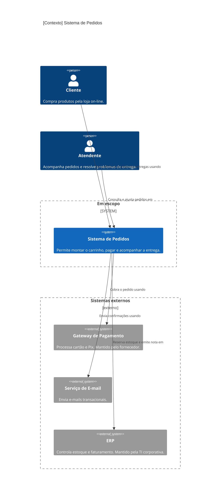
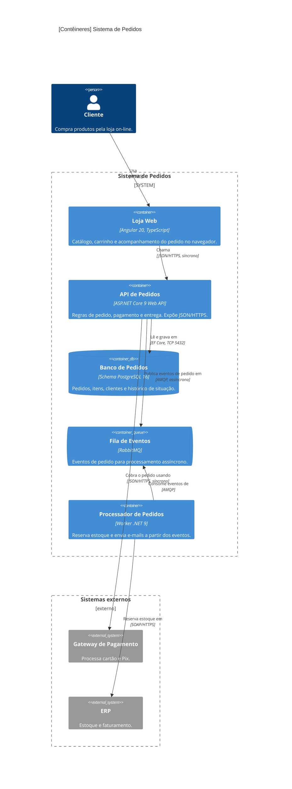
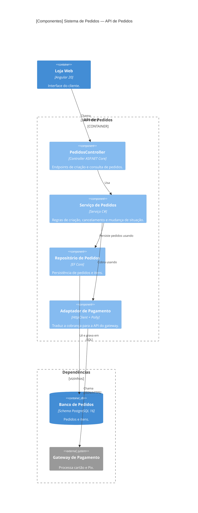
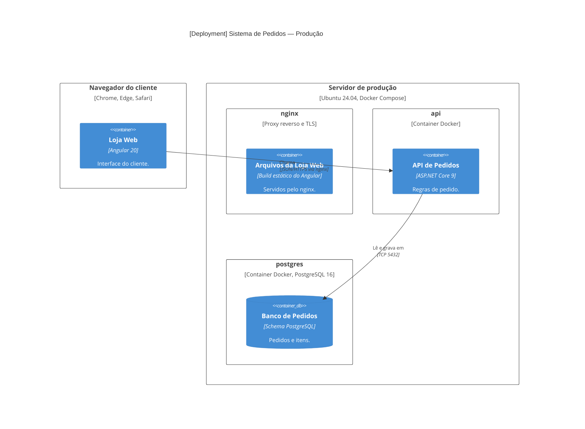
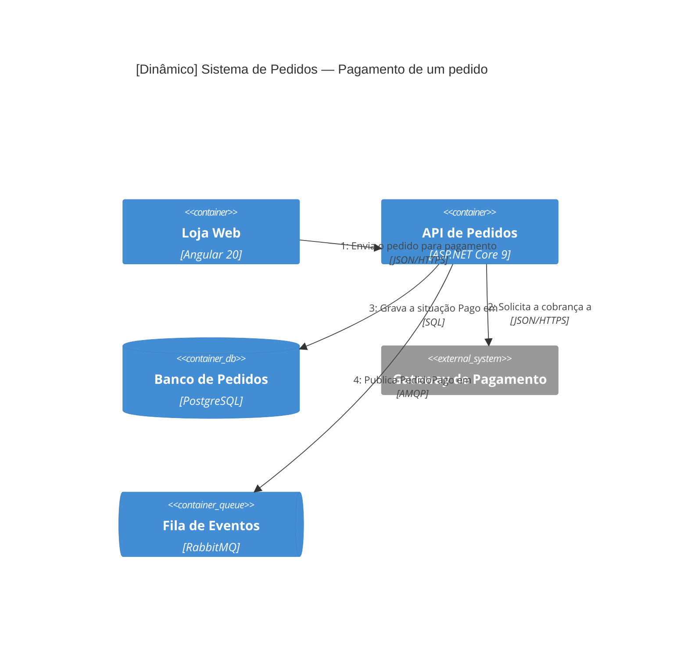

# Mermaid C4

Sintaxe conferida na documentação do Mermaid (v11). O suporte a C4 no Mermaid é **experimental**: a sintaxe é compatível com o C4-PlantUML, mas o layout é simples e alguns recursos não existem.

## Limitações que afetam a skill

| Limitação | Como contornar |
|-----------|----------------|
| Sem legenda (`SHOW_LEGEND`, `tags`, `sprite`, `link` não suportados) | Tabela de legenda em Markdown logo abaixo do diagrama |
| Layout não é automático: elementos soltos vêm **antes** de todos os limites (`*_Boundary`), e dentro de cada grupo vale a ordem das declarações | Siga o padrão de layout abaixo; ajuste com `UpdateLayoutConfig` |
| `Lay_U`, `Lay_D`, `Lay_L`, `Lay_R` não existem | Use `Rel_U`/`Rel_D`/`Rel_L`/`Rel_R` para sugerir a direção da seta |
| Rótulos de relação se sobrepõem | `UpdateRelStyle(de, para, $offsetX="...", $offsetY="...")` |
| `RelIndex` ignora o número | No diagrama dinâmico, a numeração segue a ordem dos `Rel` |

## Padrão de layout

Para ficar como o livro recomenda (pessoas em cima, sistema no centro, dependências embaixo) e igual em todos os diagramas:

1. **Pessoas** soltas, declaradas primeiro: ficam em cima.
2. **Sistema em escopo** (ou o contêiner detalhado) dentro do seu limite.
3. **Sistemas externos** dentro de `Boundary(externos, "Sistemas externos", "externo") { }`, declarado por último: ficam embaixo. Sem esse limite, o Mermaid os coloca soltos em cima, junto com as pessoas.
4. `UpdateLayoutConfig($c4ShapeInRow="2", $c4BoundaryInRow="1")` para diagramas de contêineres e componentes; `"3"` no contexto.
5. Rótulo sobreposto: `UpdateRelStyle` com `$offsetX`/`$offsetY`.

## Regras de escrita

- **Alias** (primeiro parâmetro): só letras, números e `_`, sem acento nem hífen (`api`, `banco_pedidos`, `spa`).
- **Textos** sempre entre aspas: `"Sistema de Pedidos"`. Acentos são aceitos dentro das aspas.
- Quebra de linha numa descrição: ` `.
- Um elemento por linha; limites (`*_Boundary`) com `{ }`.
- Bloco de código com a linguagem `mermaid`.

## Elementos

| Nível | Elementos |
|-------|-----------|
| Contexto | `Person(alias, "Nome", "Descrição")`, `Person_Ext`, `System(alias, "Nome", "Descrição")`, `System_Ext`, `SystemDb`, `SystemDb_Ext`, `SystemQueue`, `SystemQueue_Ext`, `Enterprise_Boundary(alias, "Nome") { }`, `System_Boundary`, `Boundary(alias, "Nome", "tipo")` |
| Contêineres | `Container(alias, "Nome", "Tecnologia", "Descrição")`, `ContainerDb`, `ContainerQueue`, `Container_Ext`, `ContainerDb_Ext`, `ContainerQueue_Ext`, `Container_Boundary(alias, "Nome") { }` |
| Componentes | `Component(alias, "Nome", "Tecnologia", "Descrição")`, `ComponentDb`, `ComponentQueue`, `Component_Ext`, `ComponentDb_Ext`, `ComponentQueue_Ext` |
| Deployment | `Deployment_Node(alias, "Nome", "Tipo", "Descrição") { }` (atalhos `Node`, `Node_L`, `Node_R`) |
| Relações | `Rel(de, para, "Rótulo", "Tecnologia")`, `BiRel`, `Rel_U`, `Rel_D`, `Rel_L`, `Rel_R`, `Rel_Back`, `RelIndex(n, de, para, "Rótulo")` |
| Estilo | `UpdateElementStyle(alias, $bgColor="...", $fontColor="...", $borderColor="...")`, `UpdateRelStyle(de, para, $textColor="...", $lineColor="...", $offsetX="...", $offsetY="...")`, `UpdateLayoutConfig($c4ShapeInRow="3", $c4BoundaryInRow="1")` |

Tipos de diagrama: `C4Context`, `C4Container`, `C4Component`, `C4Dynamic`, `C4Deployment`.

---

## Exemplo — Contexto

| Legenda | Significado |
|---------|-------------|
| Pessoa | Usuário do sistema |
| Caixa azul | Sistema em escopo (construído pelo time) |
| Caixa cinza | Sistema externo (outro dono) |
| Seta | Dependência, do iniciador para o receptor |

---

## Exemplo — Contêineres

---

## Exemplo — Componentes

| Componente | Código |
|------------|--------|
| PedidosController | `src/Pedidos.API/Controllers/PedidosController.cs` |
| Serviço de Pedidos | `src/Pedidos.Application/Pedidos/` |
| Repositório de Pedidos | `src/Pedidos.Infrastructure/Repositories/PedidoRepository.cs` |
| Adaptador de Pagamento | `src/Pedidos.Infrastructure/ExternalServices/Pagamento/` |

---

## Exemplo — Deployment

---

## Exemplo — Dinâmico

A numeração (1, 2, 3, 4) sai da ordem dos `Rel`.

---

## Problemas comuns

| Sintoma | Causa provável | Correção |
|---------|----------------|----------|
| Diagrama não renderiza | Alias com hífen, acento ou espaço; aspas faltando | Alias só com letras, números e `_`; textos entre aspas |
| Erro em descrição com vírgula | Texto sem aspas | Coloque o texto entre aspas |
| Elementos em uma linha só, muito largo | Muitos elementos por linha | `UpdateLayoutConfig($c4ShapeInRow="3")` |
| Rótulos em cima de outros | Relações paralelas | `UpdateRelStyle` com `$offsetX`/`$offsetY`, ou mude a ordem das declarações |
| Diagrama ilegível | Elementos demais | Divida em diagramas menores (ver "Escopo do diagrama" em `notacao.md`) |
